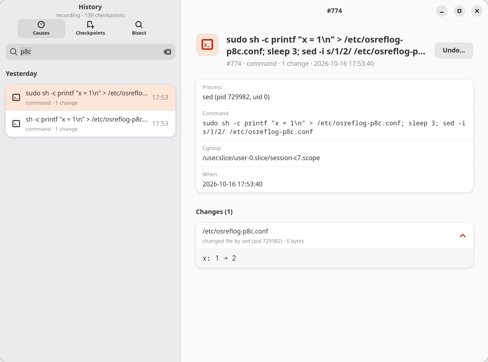
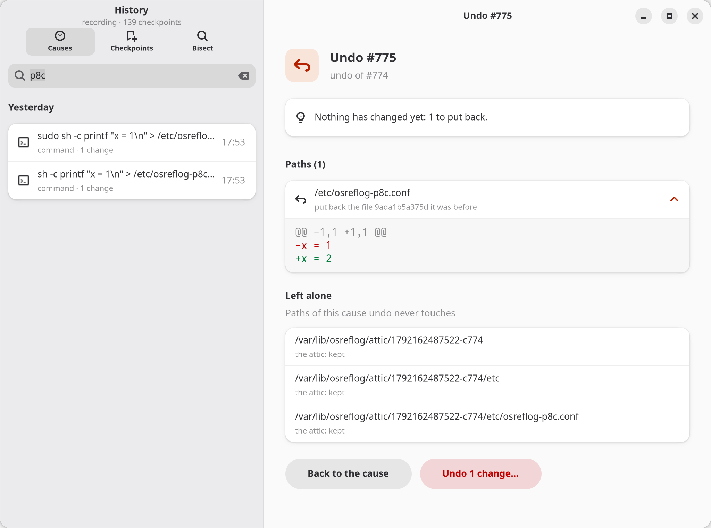
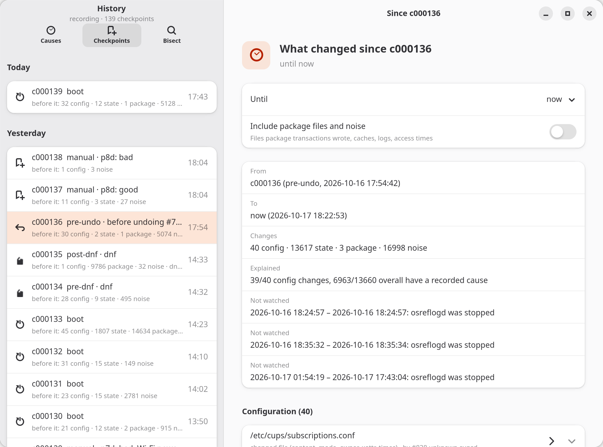
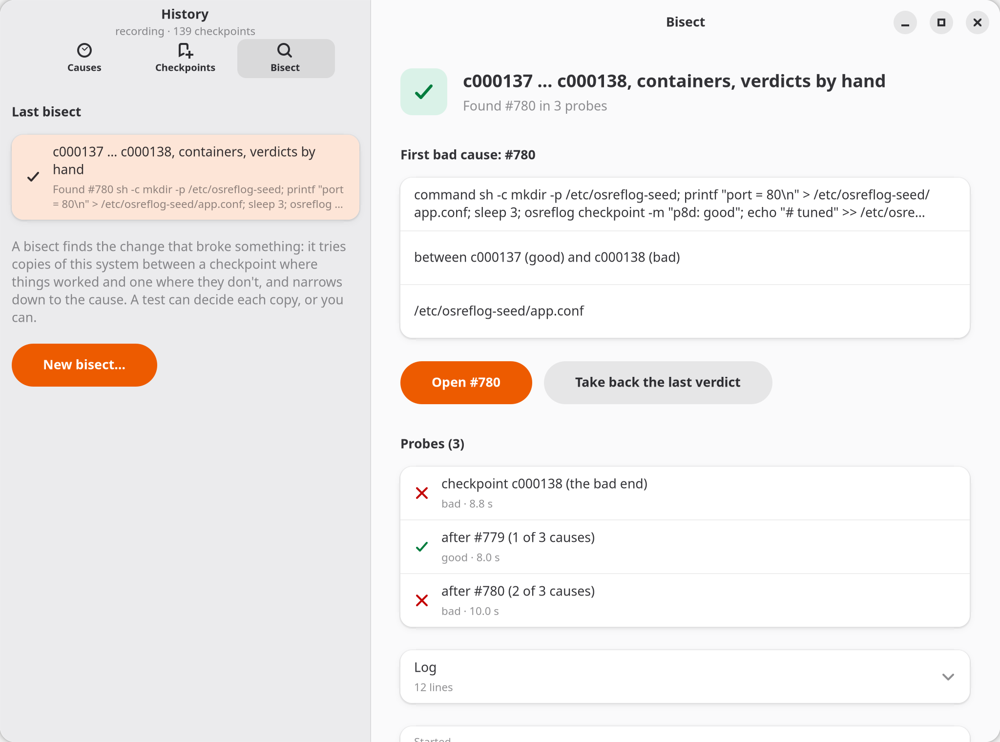

<h1 align="center">osreflog</h1>

<p align="center"><b>A reflog for your Linux system.</b><br>See what changed, what changed it, undo it, and bisect the change that broke things.</p>

<p align="center">
  <a href="https://github.com/KhaledSaeed18/osreflog/releases/latest"></a>
  <a href="https://copr.fedorainfracloud.org/coprs/khaledsaeed18/osreflog/"></a>
  
  
  <a href="https://github.com/KhaledSaeed18/osreflog/actions/workflows/ci.yml"></a>
  <a href="LICENSE"></a>
</p>

"It worked last week." Wi-Fi drops, suspend stops working, an app won't start, and somewhere in between something changed: a package update, a config edit, a service that rewrote its own file, a command you ran at 2 a.m. Snapshots (Snapper, Timeshift) can take you back, but they can't tell you *what* changed, *what made* each change, or *which one* broke things.

osreflog records every change to your system together with its cause, and gives you git's tools for it.

<picture>
  <source media="(prefers-color-scheme: dark)" srcset="docs/images/screenshots/cause-dark.png">
  
</picture>

<p align="center"><sub>Real history from the development laptop, captured with <code>scripts/screenshots.sh</code>.</sub></p>

## git, for the whole system

| You know this from git | osreflog | What it does |
|---|---|---|
| `git reflog` | `osreflog log` | Checkpoints of the system (btrfs snapshots), with what changed since each one |
| `git diff A..B` | `osreflog diff c40..@{now}` | Files and packages that changed between two checkpoints, config changes summarised by meaning |
| `git log -p -- path` | `osreflog why /etc/…` | Every change to a path: when, by which command, service or package transaction, and the diff |
| `git show` | `osreflog show 774` | One cause and everything it changed |
| `git revert` | `osreflog undo 774` | Puts back what the cause changed, path by path, after a dry run; never overwrites a later change |
| `git bisect run` | `osreflog bisect run --good c40 -- test.sh` | Finds the cause that broke something, in throwaway copies of the system |

References work as in git: `c42`, `@{1}`, `@{now}`, `@{boot-1}`, `@{yesterday}`.

## A tour, with real output

Who changed this file, and how?

```console
$ osreflog why /etc/osreflog-p8c.conf
~ 2026-10-16 17:53:40  /etc/osreflog-p8c.conf  [content kept]
  by #774 command: sudo sh -c printf "x = 1\n" > /etc/osreflog-p8c.conf; sleep 3; sed -i s/1/2/ /etc/osreflog-p8c.conf
  process sed (pid 729982)
  · x: 1 → 2
  @@ -1,1 +1,1 @@
  -x = 1
  +x = 2

+ 2026-10-16 17:53:37  /etc/osreflog-p8c.conf  [content kept]
  by #773 command: sh -c printf "x = 1\n" > /etc/osreflog-p8c.conf; …
  process sh (pid 729982)
  · new file (1 lines)
```

What did that dnf transaction do?

```console
$ osreflog diff @{1}..@{0}
from c000002 (pre-dnf, 2026-10-15 10:04:17)
to   c000003 (post-dnf, 2026-10-15 10:04:22)
     1 config · 1 state · 77 package · 32 noise · seen by: state · 733 commands, 94 KiB stream, 5638 ms, cached
     dnf #27 dnf remove -y figlet (uid 1000, ok)

packages (1):
  remove    figlet.x86_64  2.2.5-39.fc44

files (2):
  ~ /etc/ld.so.cache  [config file content,mode,owner,xattr,times]
  ~ /var/lib/rsyslog/imjournal.state  [state file content,mode,owner,xattr,times]

109 package-owned and noise paths hidden (--all to show)
```

Something broke between two checkpoints. Which change was it?

```console
$ osreflog bisect log
bisect c000137 … c000138 (tier Nspawn, by hand), started 2026-10-16 18:36:09
   1  bad   checkpoint c000138 (the bad end)
   2  good  after #779 (1 of 3 causes)
   3  bad   after #780 (2 of 3 causes)

first bad cause: #780  2026-10-16 18:04:19  command  sh -c mkdir -p /etc/osreflog-seed; …
  /etc/osreflog-seed/app.conf
between c000137 (good) and c000138 (bad)
probes: 3 (1 on checkpoints, 2 on causes) · tier Nspawn · approximations: none
next: osreflog show 780 · osreflog undo 780
```

Bisect narrows to a single *cause*, not just a snapshot: the history can rebuild the state between two checkpoints, after any one cause.

## The app

Everything above, in a GNOME app: the timeline of causes with search, any two checkpoints compared, an undo you see before it happens, and a bisect you can drive by hand.

<picture>
  <source media="(prefers-color-scheme: dark)" srcset="docs/images/screenshots/undo-dark.png">
  
</picture>

<picture>
  <source media="(prefers-color-scheme: dark)" srcset="docs/images/screenshots/since-dark.png">
  
</picture>

<picture>
  <source media="(prefers-color-scheme: dark)" srcset="docs/images/screenshots/bisect-dark.png">
  
</picture>

## Safe by construction

osreflog writes to your system only when you ask it to undo something, and it boots probes on real hardware only when you ask for that. Both were gated before they shipped ([roadmap](docs/roadmap.md): the write gate and the boot gate).

- **Undo is a dry run by default.** It shows each path and what it would do; `--apply` (or the app's button) asks once more and then polkit asks for the password.
- **Nothing is silently overwritten.** Each path is checked again as it is written: one that changed since the cause is a conflict and is left alone. Replaced versions go to an attic, never deleted, and the undo is a cause of its own, so it can be undone too.
- **A checkpoint first.** Every undo takes and verifies a checkpoint before it writes anything.
- **Probes are throwaway copies.** Bisect runs each test in an ephemeral container or a VM booting the copy's own kernel. A reboot into a copy on real hardware is a one-shot boot entry: the default entry is checked untouched after every probe, and a hung probe falls back to it on the next power cycle ([recovery](docs/recovery.md)).
- **Secrets are never stored.** Files such as `/etc/shadow`, Wi-Fi and VPN credentials and private keys are recorded as changed, with a hash, never their content; `password=`-style keys in config diffs and secrets in command lines are redacted ([threat model](docs/threat-model.md)).
- **A tamper-evident history.** The ledger is hash-chained; `osreflog verify` re-checks it.
- **Sandboxed services.** The daemon keeps only the capabilities its job needs and refuses system calls it never makes; the settings agent sees your home read-only, has no network and no capabilities; under SELinux the history has types of its own that confined services can't read.

## How it works

```
                  ┌────────────────────── osreflogd (root, Rust) ──────────────────────┐
 live witness ──► │ fanotify (fs-wide mark) + eBPF exec/fork lineage ──► cause builder │
                  │ dnf5 actions hook · dnf5 history · systemd units · D-Bus callers   │
                  │                              │                                     │
 state witness ─► │ btrfs checkpoints (read-only snapshots) ──► send-stream diff       │
                  │                              ▼                                     │
                  │        ledger (SQLite, hash-chained) + content blobs (zstd)         │
                  └────────┬──────────────────────┬──────────────────────┬─────────────┘
                           │ D-Bus + polkit       │                      │
                     CLI · GNOME app        undo (3-way,           bisect probes:
                                            checkpoint first)      nspawn · KVM · metal
```

- **Two witnesses.** The live witness records *who* changed each file as it happens: fanotify sees the write, eBPF traces the process back to its command, service or package transaction. The state witness proves *what* changed, from the stream `btrfs send --no-data` produces between two snapshots. When they disagree (a change made while the daemon was stopped), that is reported, not hidden.
- **Causes, not files.** Changes are grouped into causes: a dnf transaction, a systemd unit, a terminal command, an app writing a setting, a daemon acting for the D-Bus caller who asked it. You read, undo and bisect whole causes.
- **Your settings too.** `osreflog user` records your own dconf/GSettings changes with the app that made them, in your own ledger.
- **Three probe tiers.** A `systemd-nspawn` container on a snapshot (under a second), a KVM VM booting the snapshot's own kernel over virtiofs (about 14 s), or a one-shot reboot into the snapshot on this machine (for hardware-only regressions).

Built on btrfs, fanotify, eBPF (aya), dnf5/RPM, systemd, KVM/QEMU with virtiofs, D-Bus and polkit, GTK 4 and libadwaita. More in [Architecture](docs/architecture.md).

## Measured

On the development laptop (Fedora 44, i7-8550U, SATA disk). Every number has a script that measures it again: see [Validation](docs/validation.md), with what isn't validated yet.

| | |
|---|---|
| Cached diff of a dnf transaction | 6 ms |
| Added to a dnf transaction | under a second (two checkpoints) |
| Daemon at rest | 0.08 % of one CPU |
| Container probe / VM probe | ≤ 0.9 s / ≤ 14 s at ≤ 436 MiB |
| Undo gate (conflicts, symlink swaps, SELinux labels, xattrs, renames) | 16/16, 0 escapes in a symlink-swap race |
| Seeded regressions found by bisect | 5/5 within ⌈log₂ n⌉ + 1 probes |
| Metal bisect (Wi-Fi power save) | found in 3 probes, the default boot entry untouched |

## Install

Fedora Workstation with `/` on btrfs (the default layout), x86_64, from [COPR](https://copr.fedorainfracloud.org/coprs/khaledsaeed18/osreflog/):

```bash
sudo dnf copr enable khaledsaeed18/osreflog
sudo dnf install osreflog osreflog-app
sudo systemctl enable --now osreflogd.service osreflog-boot-doctor.service
systemctl --user enable --now osreflog-user.service
osreflog doctor
```

The app is **osreflog** in the app grid. The services follow Fedora's presets, so they are enabled by hand once; updates arrive with `dnf upgrade`. Fedora 44, 45 and rawhide are built; the [release RPMs](https://github.com/KhaledSaeed18/osreflog/releases), building from source and removing osreflog are in [Installing](docs/install.md), and common problems in [Troubleshooting](docs/troubleshooting.md).

### Scope

One btrfs filesystem for `/` on Fedora (Workstation's default since Fedora 33). Immutable systems such as Silverblue and NixOS keep their own history and are out of scope; Flatpak apps have their own (`flatpak history`), and writes under `/var/lib/flatpak` are summarised as one opaque cause.

## Documentation

- [Installing](docs/install.md) and [Troubleshooting](docs/troubleshooting.md)
- [Validation](docs/validation.md): every claim, the check behind it and its last result
- [Contributing](CONTRIBUTING.md): building, testing, the rules, releases; [Changelog](CHANGELOG.md)
- [docs/README.md](docs/README.md): the vision, the architecture, how capture, undo and bisect work, the threat model, and one journal entry per phase with what worked, what broke and the numbers

## License

[GPL-3.0-or-later](LICENSE)
